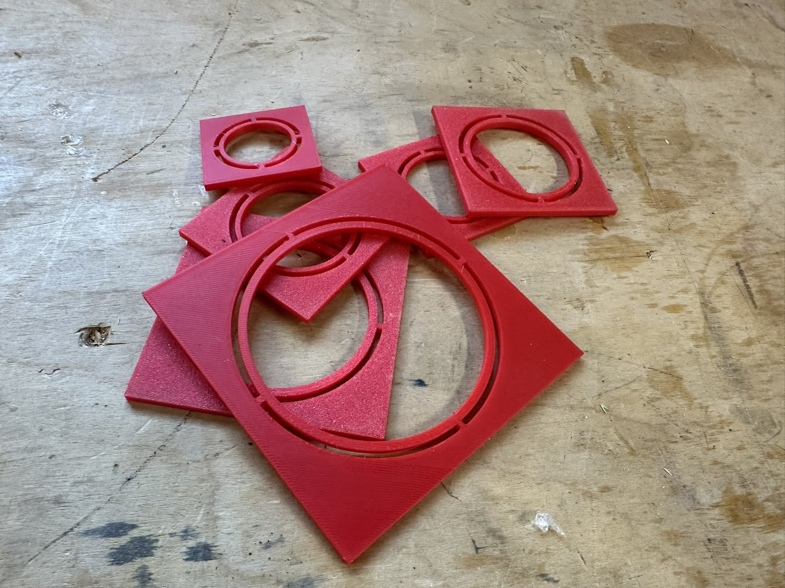
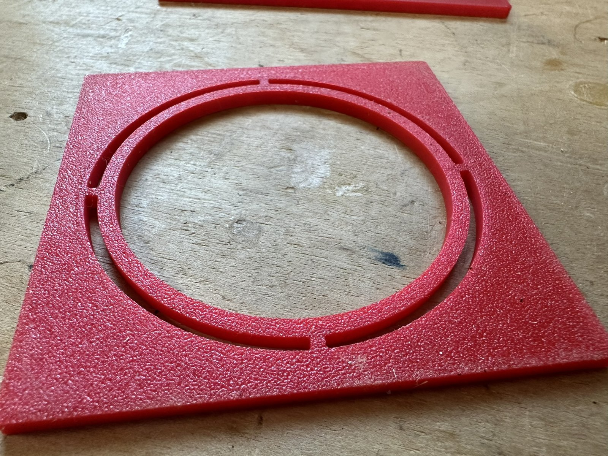
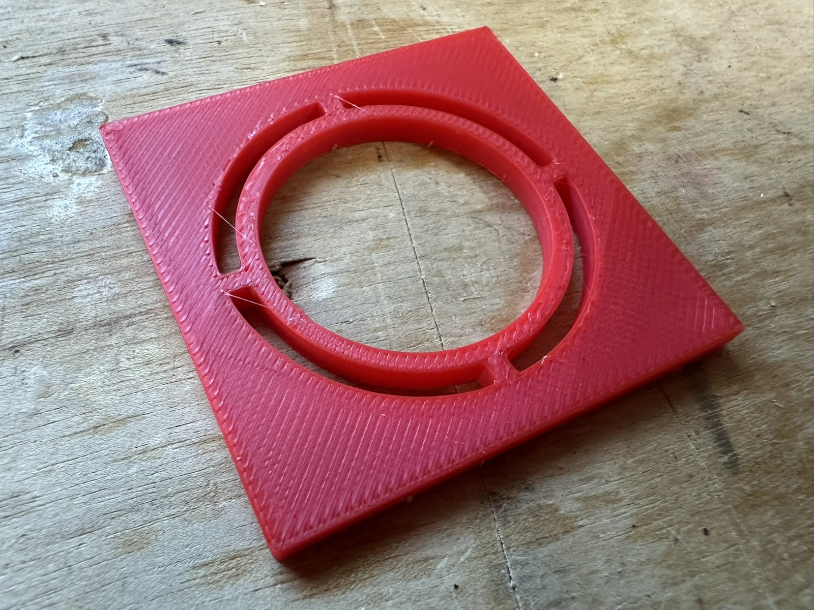

# Circle Templates

A parameterized OpenSCAD model for 3D-printing circular templates (stencils) for
marking or cutting circles in fabric, paper or other thin material.

It began in a public library makerspace with button makers. The makerspace has
punches for paper, but many people want to cover their buttons with fabric, and
used to trace around a paper cut-out. A template holds the fabric flat while you
mark the circle through the slot with a pencil, chalk or fine marker. You can
also run a knife blade around the slot to cut most of the circle, then snip the
four short gaps left by the bridges.

Nothing here is specific to buttons, so the model makes a circular stencil of
any size.

## How it's built

Each template has three parts:

- an **outer frame**, a rectangular plate;
- an **inner ring** just inside the slot, which presses the material flat right
  next to the line; the center inside the ring is open, so you can see what you
  are framing;
- four **bridges** across the slot, holding the ring to the frame.

The circle you mark is the center line of the slot.

## Files

| File | What it is |
| --- | --- |
| `circle_template.scad` | The OpenSCAD model. All settings are at the top of the file. |
| `images/` | Photos of printed templates. |

## Quick start

1. Open `circle_template.scad` in [OpenSCAD](https://openscad.org/).
2. Open the Customizer (Window → Customizer) and set the slot radius for the
   circle you want, and the template size.
3. Render (F6), export as STL or 3MF, and print it flat. No supports are needed.

## Parameters

All lengths are in millimetres.

| Parameter | Default | Meaning |
| --- | --- | --- |
| `template_width` | 100 | Width of the outer frame. |
| `template_length` | 100 | Length of the outer frame. |
| `template_thickness` | 3 | Thickness of the template. |
| `slot_width` | 2 | Width of the slot you mark or cut through. |
| `slot_radius` | 33.3375 | Distance from the center to the middle of the slot. The default marks a circle 2.625 in (66.675 mm) across, correct for a large button maker. |
| `ring_width` | 3 | Width of the inner ring. |
| `bridge_width` | 2 | Width of each of the four bridges across the slot. |
| `fill_center` | false | Leave the center solid, so the template is just a plate with a circular slot. |
| `circle_faces` | 360 | Number of faces on the circles. |

To mark a circle of diameter *D*, set `slot_radius` to *D* / 2. For a size given
in inches, multiply by 25.4 first: a 2.625 in circle is 2.625 × 25.4 / 2 =
33.3375 mm.

The frame must be wider than the slot; the model stops with a message if it
isn't, or if the ring is so wide that nothing is left for the center hole.

## Printing

The templates in the photos were printed flat. The ones with a pebbled surface
were printed on a textured plate, and the face that was on the plate picks up
the texture.

## Gallery

| | |
| --- | --- |
|  |  |
| A stack of templates. | The textured (plate) side. |
|  |  |
| The smooth (top) side. | The ring, slot and bridges up close. |
|  |  |
| A small template, textured side. | A small template, smooth side. |

## License

MIT; see [LICENSE](LICENSE).

---

*This README was written by Claude (Anthropic) at Bob Drzyzgula's direction. The
model and the photographs are his.*
